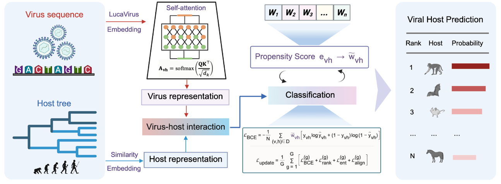

# VHE-Net

VHE-Net (Virus-Host-Ecology Net) is a dual-branch deep learning model for
virus-host association prediction. It was trained on 934 viruses and 451 hosts
and combines viral sequence features with host embeddings and host phylogeny,
with bias-aware mitigation for the strongly uneven interaction landscape.



## Repository contents

```text
VHE-Net/
|-- assets/
|   `-- architecture.png
|-- cache/
|   `-- README.md
|-- checkpoints/
|   `-- README.md
|-- configs/
|   `-- vhe_net_with_weight.yaml
|-- data/
|   |-- host_similarity.csv
|   |-- interactions.xlsx
|   |-- true_labels_manifest.json
|   |-- virus_sequences.fasta
|   `-- whiten_stats.pt
|-- pretrained/
|   `-- README.md
|-- vhenet/
|   |-- __init__.py
|   |-- dataset.py
|   |-- encode.py
|   |-- encode_ids.py
|   |-- layers.py
|   |-- losses.py
|   |-- metrics.py
|   |-- model.py
|   `-- preprocessing.py
|-- LICENSE
|-- README.md
|-- predict.py
|-- requirements.txt
|-- check_env.py
`-- train.py
```

The `cache/`, `checkpoints/`, and `pretrained/` directories contain only
placeholder README files in Git. Their large binary artifacts are ignored and
must be obtained or generated separately.

## 1. Environment setup

Training requires a Linux server with an NVIDIA GPU. Run the commands below from
the repository root.

```bash
git clone https://github.com/JYuan-Lab/VHE-Net.git
cd VHE-Net

conda create -n VHE-Net python=3.10 -y
conda activate VHE-Net
pip install -r requirements.txt
```

The pinned PyTorch wheel is `torch==2.5.1+cu118`. If your server uses a different
CUDA toolkit, install the matching PyTorch build before installing the remaining
dependencies.

### Required files

| File or directory | Purpose | How to obtain it |
|---|---|---|
| `data/interactions.xlsx`, `data/virus_sequences.fasta` | Interaction labels and viral nucleotide sequences | Included in this repository |
| `data/host_similarity.csv`, `data/whiten_stats.pt` | Host similarity matrix and whitening statistics | Included in this repository |
| `pretrained/lucaVirus/` | LucaVirus encoder directory | Obtain separately; see `pretrained/README.md` |
| `cache/ids_km_cache_934/`, `cache/cls_windows_cache_934.pt` | Precomputed training features | Generated in step 2; see `cache/README.md` |
| `checkpoints/vhe_net_with/` | Trained model weights | Generated by training in step 2; see `checkpoints/README.md` |

After placing the LucaVirus weights, verify that the environment reproduces the
released feature cache:

```bash
python check_env.py
```

## 2. Build caches and train

First build the token-id cache, then encode the window CLS features. The encoder
is invoked only during cache construction; training and prediction read the
precomputed features.

```bash
python -m vhenet.encode_ids \
  --fasta data/virus_sequences.fasta \
  --cache-dir cache/ids_km_cache_934 \
  --window 1022 --stride 512 --kmer 6

python -m vhenet.encode \
  --fasta data/virus_sequences.fasta \
  --model-path pretrained/lucaVirus \
  --cache-dir cache/cls_windows_cache_934 \
  --packed-path cache/cls_windows_cache_934.pt \
  --window 1022 --stride 512 \
  --whiten-stats data/whiten_stats.pt
```

Then train the model:

```bash
python train.py --config configs/vhe_net_with_weight.yaml
```

The importance-weighted model writes weights to `checkpoints/vhe_net_with/` and
training records to `outputs/with/`. The configuration trains for at most 200
epochs, selects the best checkpoint by validation Spearman correlation, and uses
an early-stopping patience of 100 epochs. The default device is `cuda:0`;
confirm that this GPU is available before starting.

## 3. Export and check predictions

After training, export predictions with `last_model.pt` (or `best_model.pt` for
the final epoch):

```bash
python predict.py \
  --config configs/vhe_net_with_weight.yaml \
  --checkpoint checkpoints/vhe_net_with/last_model.pt \
  --out outputs/with/predictions.csv
```

The CSV has 421,234 rows, covering every combination of 934 viruses and 451
hosts. `Virus` and `Host` identify the pair, and `Probability` is the predicted
association score.

Note the `Label` and `Split` columns. The current script predicts every host for
each virus and, for duplicate virus-host pairs, keeps the `val` row. Therefore,
`Split == "val"` does not guarantee that the pair belonged to the original
validation set, and `Label` only reflects the positive examples in that fold.
To compute validation metrics, restore the original validation pairs and look up
their labels in the interaction table by `Virus` and `Host`.

## Quick prediction

An interactive web application accepts viral sequences in FASTA format and
returns ranked candidate hosts with predicted association probabilities:
<https://vhe-net.ylab-bioinfo.cn/>.


## Weights and caches

The LucaVirus backbone, feature caches, and checkpoints are too large for normal
Git tracking. They can be requested from the corresponding author or rebuilt with
the commands above. Detailed layouts and rebuild notes are in
`pretrained/README.md`, `cache/README.md`, and `checkpoints/README.md`.

## Citation

If you use VHE-Net, please cite:

> Ecologically informed deep learning for viral host prediction and proactive
> spillover surveillance (under review).

## Contact

Correspondence: <yuan_jiao@gzlab.ac.cn>

## License

This project is released under the MIT License. See `LICENSE` for details.
